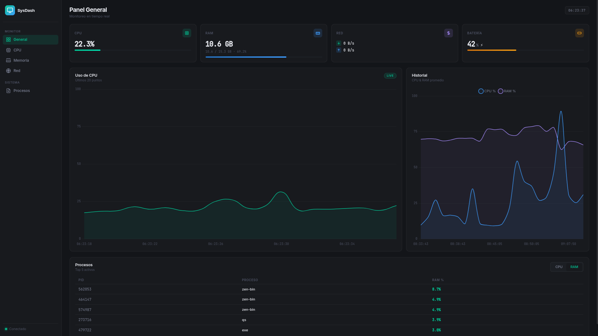

# SysDash

Panel de monitoreo del sistema de escritorio, implementado en Rust. La aplicación se ejecuta de forma nativa en Linux y no inicia Electron, Node.js ni un servidor web.



## Funciones

- Uso de CPU y memoria en tiempo real.
- Tráfico de red por segundo.
- Procesos principales por CPU o memoria.
- Gráficas de uso e historial local.
- Historial persistido en SQLite.

## Requisitos para compilar

- Rust y Cargo (edition 2024).
- Dependencias gráficas de egui: OpenGL, X11 o Wayland.

## Compilar y ejecutar

```sh
cargo run --release
```

La base SQLite se guarda en `~/.local/share/sys-dashboard/database.sqlite` (o en el directorio de datos local equivalente del sistema).

## Arch Linux

El paquete `PKGBUILD` compila e instala el ejecutable Rust directamente, sin Node.js ni Electron.
